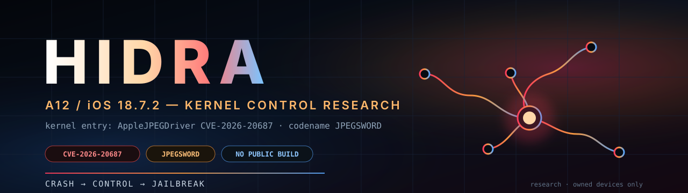

<p align="center">
  
</p>

<p align="center">
  
  
  
  
</p>

# HIDRA

**A12 / iOS 18.7.2 — from AppleJPEGDriver UAF to kernel r/w.**

Hidra is a research jailbreak project for A12 devices on iOS 18.7.2. It builds
on the kernel UAF in `AppleJPEGDriver` (CVE-2026-20687) and the controlled
free/reclaim work in [`hidgate-poc`](https://github.com/nenasevartem70-cmyk/hidgate-poc).

> **There is no public jailbreak build yet.**
> Hidra is a research project, not a working jailbreak. It does not provide
> kernel read/write today, does not bypass PAC/PPL/SPTM yet, and does not
> install anything. Do not run research builds on a primary phone.

> **«Паника — это не конец. Это доказательство, что мы уже в ядре.»**
> **Crash → Control → Jailbreak.**

## Why Hidra

The first path (`IOHIDFamily`, CVE-2026-28992) is crash-only on the reachable
SPU provider: the freed object is provider-side and `copyEvent` never delivers
an event on this target. The second path (`AppleJPEGDriver`,
CVE-2026-20687) is different:

- the userclient opens from the normal app sandbox;
- the `0x58` decode ABI works;
- a true sync decode can be driven into `kIOReturnTimeout`;
- the freed `JpegRequest` can be reclaimed with a same-type request;
- the driver can be left in a persistent stale/power-wedged state.

That is enough to start building a kernel primitive. It is not enough for a
jailbreak yet.

## How it will work

```mermaid
flowchart LR
    A[Sideloaded app] --> B[AppleJPEGDriver userclient]
    B --> C[Prime async decodes]
    C --> D[Sync decode + 10 s timeout]
    D --> E[Freed JpegRequest + stale queue node]
    E --> F[Same-type reclaim]
    F --> G[Double-free / write primitive]
    G --> H[KASLR leak]
    H --> I[PAC bypass]
    I --> J[PPL / SPTM bypass]
    J --> K[Kernel patch + bootstrap]
    K --> L[Hidra package]
```



### Stage 0 — Entry

A sideloaded app opens `AppleJPEGDriver` type 0, submits async decodes, and
forces a synchronous decode into the 10 s timeout. This is already working on
the test device.

### Stage 1 — Kernel primitive

The timeout frees a `JpegRequest` while its embedded queue node remains in the
per-codec vector. A same-type allocation replaces the freed object. The next
goal is to turn this into one of:

- a **double-free** of `JpegRequest`;
- a refcount corruption of the request's `IOSurface` or `IOUserClient`;
- a **write** through the queue node or the decoder's buffer setup.

The public PoC's `*(*(request+0)+0x28)()` path is PAC-protected on A12
(`autda` + `blraa`), so a fake vtable is not the first move.

### Stage 2 — KASLR

A kernel read or a side channel must reveal the kernel slide and the addresses
of the objects used by the primitive. The standard `proc_pidfdinfo`,
`mach_port_kobject`, and `mach_vm_region` surfaces are clean on 18.7.2.

### Stage 3 — PAC

A12 is arm64e. The kernel uses PAC for function pointers and data pointers.
Hidra needs either a signing gadget/oracle, a data-only path that avoids
authenticated pointers, or a leak of a valid signed pointer.

### Stage 4 — PPL / SPTM

Kernel text and page tables are protected. The project needs a data-only
page-table attack, a PPL bypass, or a supported kernel patch primitive before
it can install a bootstrap.

### Stage 5 — Persistence and package

The first target is a **semi-tethered** jailbreak: the device boots normally,
the user runs the Hidra app after a reboot, and the bootstrap is reapplied.
Untethered persistence is a later goal.

The package will ship as:

- a signed/unsigned IPA for sideloading;
- an on-device bootstrap (launchd hook / substitute);
- a desktop helper for install and recovery.

## Status

| Stage | Component | State |
|---|---|---|
| S0 | Entry app + AppleJPEG userclient | **DONE** |
| S1 | Deferred `JpegRequest` UAF | **DONE** |
| S2 | Controlled 10 s free | **DONE** |
| S3 | Same-type reclaim | **DONE** |
| S4 | Double-free / write primitive | **IN PROGRESS** |
| S5 | KASLR + PAC | **NOT STARTED** |
| S6 | PPL / SPTM + persistence | **NOT STARTED** |
| S7 | Package / bootstrap | **NOT STARTED** |

The detailed control ladder is in
[`hidgate-poc/docs/kernel-control.md`](https://github.com/nenasevartem70-cmyk/hidgate-poc/blob/main/docs/kernel-control.md).

## Supported devices (target)

| Device | SoC | iOS | State |
|---|---|---|---|
| iPhone XR (`iPhone11,8`) | A12 / T8020 | 18.7.2 (22H124) | **Primary test device** |
| iPhone XS / XS Max | A12 | 18.7.x | Untested; same kext family likely |
| iPhone 11 / SE 2 | A13 | 18.7.x | Untested; may share the driver |
| iPhone 12 and newer | A14+ | any | **Not supported initially** |
| iOS 18.7.7+ / 26.4+ | — | — | **Patched**, not supported |

The project starts with the device we can test: iPhone XR on 18.7.2. Support
for other A12/A13 devices will be added only after the kernel primitive is
stable.

## Release plan and possible date

There is **no promised release date**. The date below is a research estimate
and will slip if a stage fails.

| Milestone | Target window | Exit criterion | Confidence |
|---|---|---|---|
| M4 | Nov–Dec 2026 | reproducible double-free or write primitive | medium-low |
| M5 | Dec 2026–Feb 2027 | KASLR leak + PAC bypass or data-only path | low |
| M6 | Mar–May 2027 | PPL/SPTM bypass + bootstrap prototype | low |
| M7 | **Q2 2027** | closed beta on iPhone XR 18.7.2 | low |
| M8 | **Q3 2027** | public beta, if M4–M6 pass | low |

**Possible public release window: Q3 2027.** This is not a promise. If PAC or
PPL cannot be bypassed, Hidra may ship as a kernel r/w research toolkit
instead of a jailbreak.

## Repository layout

```
hidra/
  README.md
  docs/
    architecture.md      # exploit chain, stage by stage
    roadmap.md           # milestones, dates, exit criteria
    faq.md               # device/support questions
  assets/
    banner.svg
  SECURITY.md
  LICENSE
```

The research base, PoCs, panic logs, and test matrix live in
[`hidgate-poc`](https://github.com/nenasevartem70-cmyk/hidgate-poc).

## Research base

- [Kernel control ladder](https://github.com/nenasevartem70-cmyk/hidgate-poc/blob/main/docs/kernel-control.md)
- [Final test matrix](https://github.com/nenasevartem70-cmyk/hidgate-poc/blob/main/docs/final-tests.md)
- [AppleJPEG CVE notes](https://github.com/nenasevartem70-cmyk/hidgate-poc/blob/main/docs/applejpeg-cve-2026-20687.md)
- [AppleJPEG panic analysis](https://github.com/nenasevartem70-cmyk/hidgate-poc/blob/main/docs/applejpeg-panic-2026-10-30.md)
- [Experiment log](https://github.com/nenasevartem70-cmyk/hidgate-poc/blob/main/docs/experiment-log.md)
- [Apple security content, iOS 18.7.7](https://support.apple.com/en-us/126793)
- [CVE-2026-20687](https://www.cve.org/CVERecord?id=CVE-2026-20687)
- [Public AppleJPEG PoC](https://github.com/0xjohnnydev/CVE-2026-20687-AppleJPEGDriver-UAF)

## FAQ

**Is this a jailbreak?**
Not yet. It is the research project that aims to become one.

**Does it work on my iPhone?**
Only the iPhone XR on iOS 18.7.2 is being tested. iOS 18.7.7+ and 26.4+ are
patched and will not work.

**Will it be untethered?**
The first target is semi-tethered. Untethered persistence is a later goal.

**Why the name Hidra?**
Hydra: many heads, many paths into the kernel. The project started with HID
(IOHIDFamily) and continued through AppleJPEGDriver.

**When will it be released?**
The current research estimate is a closed beta in Q2 2027 and a public beta in
Q3 2027, only if the kernel primitive, KASLR/PAC, and PPL stages pass. There is
no promised date.

## Contributing

- Test devices: A12/A13 on iOS 18.7.x with a spare phone.
- Crash logs: `panic-full-*.ips` with the AppleJPEGDriver signature.
- Reverse engineering: AppleJPEGDriver 7.6.9, PAC/PPL, IOSurface.
- Write-ups: reproducible results, not just screenshots.

Open an issue with the device, build, log, and exact steps.

## Warning

- Research builds can panic, reboot, or wedge the JPEG driver's power state.
- Do not run them on a primary phone.
- Do not use this project for malware, unauthorized access, or piracy.
- The CVEs are public and fixed; this is security research on owned devices.

## License

MIT. See [`LICENSE`](LICENSE).
